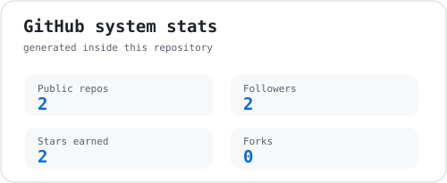
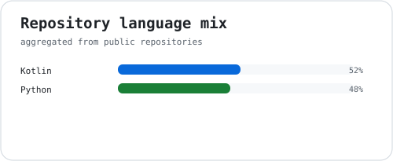

<h1>Jihad Tiazziti</h1>

<strong>Mobile Application Developer</strong>

Android · Kotlin · Flutter · Firebase

Based in Morocco · Open to internships &amp; junior roles

<a href="https://www.linkedin.com/in/jihad-tiazziti/">LinkedIn</a> &nbsp;·&nbsp;
<a href="https://jihadtiazziti.netlify.app">Portfolio</a> &nbsp;·&nbsp;
<a href="https://www.instagram.com/ry_vnn17/">Instagram</a>

---

## About me

Hi, I'm **Jihad**, a mobile application developer focused on **Android and Kotlin**, with experience building cross-platform apps using **Flutter and Dart**.

I enjoy building practical applications, connecting clear interfaces to real data, and improving my projects step by step.

- **Focus:** Android development, mobile UI and data integration.
- **Currently building:** J-Shop and G-Stock.
- **Looking for:** internships and junior Mobile / Android Developer opportunities.

## Technologies

| Area | Technologies |
| :--- | :--- |
| Languages | Kotlin · Dart · SQL |
| Mobile | Android SDK · XML · Flutter |
| Data & backend | Firebase · Room · SQLite |
| Integrations | REST APIs |
| Tools | Git · GitHub · Figma · VS Code |

## Selected projects

### 01 / J-Shop
**Android e-commerce application**

An Android project built with Kotlin and XML, using Firebase and Room / SQLite.

**Features:** authentication, product catalog, search and filters, shopping cart.

`Kotlin` `Android` `Firebase` `Room / SQLite`

[Explore the repository →](https://github.com/JihadTiazziti/J_Shop)

### 02 / G-Stock
**Inventory-management application**

A Flutter application for managing inventory, categories, members and borrowings, with local SQLite storage.

**Features:** dashboard, components, CRUD operations, search and filters.

`Flutter` `Dart` `SQLite`

[Explore my portfolio →](https://jihadtiazziti.netlify.app)

---

<strong>GitHub activity &amp; repository languages</strong>

 

<picture>
  <source media="(prefers-color-scheme: dark)" srcset="assets/card-stats-dark.svg">
  <source media="(prefers-color-scheme: light)" srcset="assets/card-stats-light.svg">
  
</picture>

 

<picture>
  <source media="(prefers-color-scheme: dark)" srcset="assets/card-languages-dark.svg">
  <source media="(prefers-color-scheme: light)" srcset="assets/card-languages-light.svg">
  
</picture>

Generated in this repository and refreshed with GitHub Actions.

---

<h3>Let's build something useful.</h3>

Available for internships and junior mobile development opportunities.

<a href="https://www.linkedin.com/in/jihad-tiazziti/"><strong>Get in touch on LinkedIn →</strong></a>

BUILD · LEARN · IMPROVE

