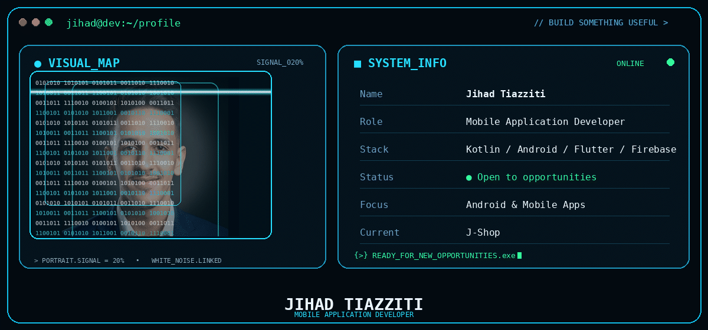

<div align="center">



</div>

---

## ⚙️ `TECH_STACK.exe`

<div align="center">


<br/><br/>


</div>

---

# 🚀 `PROJECTS/`

## 🛒 J-SHOP

> Modern Android e-commerce application built with **Kotlin, XML and Firebase**.

<p>


</p>

**Core features**  
`Authentication` • `Product Catalog` • `Search & Filters` • `Shopping Cart` • `Firebase` • `Modern UI`

---

## 📦 G-STOCK

> Inventory management application built with **Flutter, Dart and SQLite**.

<p>


</p>

**Core features**  
`Dashboard` • `Categories` • `Components` • `Members` • `Borrowings` • `CRUD` • `Search & Filters`

---

## 📊 `SYSTEM_STATS`

<div align="center">


</div>

---

## 🐍 `CONTRIBUTION_PROTOCOL`

<div align="center">


</div>

---

## 📡 `CONNECT`

<div align="center">

<a href="https://www.linkedin.com/in/jihad-tiazziti/">

</a>

<a href="https://jihadtiazziti.netlify.app">

</a>

<a href="https://github.com/JihadTiazziti">

</a>

</div>

---

<div align="center">


```text
> Thanks for visiting.
> Connection terminated... █
```

</div>
