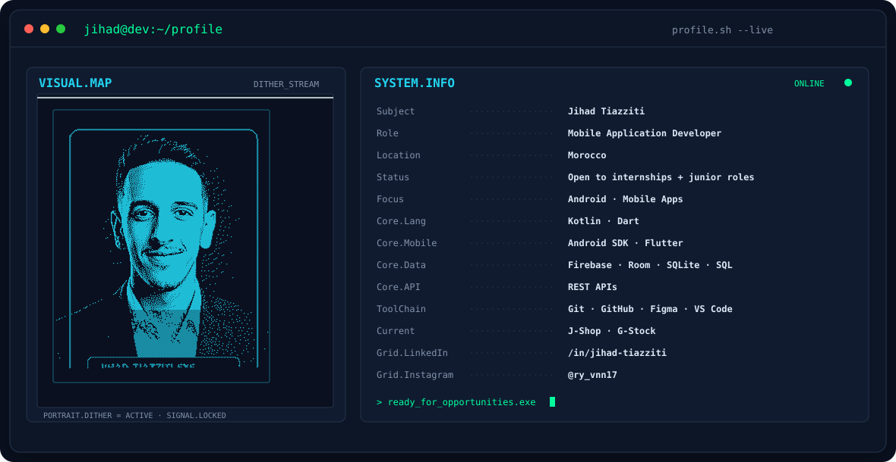
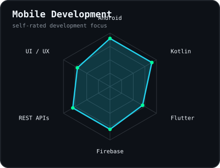
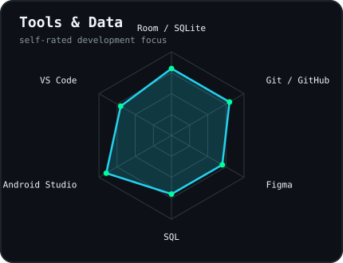
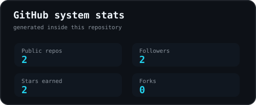
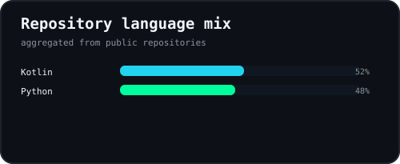

<picture>
  <source media="(prefers-color-scheme: dark)" srcset="assets/banner-dark.svg">
  <source media="(prefers-color-scheme: light)" srcset="assets/banner-light.svg">
  
</picture>

 

 

&nbsp;&nbsp;
&nbsp;&nbsp;

 

---

## 👨‍💻 About me

Hi, I'm **Jihad**, a mobile application developer focused on **Android and Kotlin**, with additional experience building cross-platform apps with **Flutter and Dart**.

I enjoy turning ideas into practical applications, connecting clean interfaces to real data, and improving a project step by step until it feels useful and reliable.

- 📱 Building Android experiences with **Kotlin, XML, Room and Firebase**.
- 🧩 Working with **SQLite, SQL and REST APIs** for app data and integrations.
- 🛒 Currently improving **J-Shop**, an Android e-commerce project.
- 📦 Also building **G-Stock**, a Flutter inventory-management application.
- 🎯 Open to **internships and junior Mobile / Android Developer opportunities**.

 

## ⚙️ my mobile stack

---

## 📡 signals

<table>
<tr>
<td width="50%" align="center" valign="middle">

<picture>
  <source media="(prefers-color-scheme: dark)" srcset="assets/radar-skills-dark.svg">
  <source media="(prefers-color-scheme: light)" srcset="assets/radar-skills-light.svg">
  
</picture>

</td>
<td width="50%" align="center" valign="middle">

<picture>
  <source media="(prefers-color-scheme: dark)" srcset="assets/radar-tools-dark.svg">
  <source media="(prefers-color-scheme: light)" srcset="assets/radar-tools-light.svg">
  
</picture>

</td>
</tr>
</table>

---

## 🚀 Selected builds

### 🛒 J-Shop

Android e-commerce application built with **Kotlin, XML, Firebase and Room / SQLite**.

**Core features:** `Authentication` • `Product Catalog` • `Search & Filters` • `Shopping Cart` • `Firebase` • `Modern UI`

### 📦 G-Stock

Inventory-management application built with **Flutter, Dart and SQLite**.

**Core features:** `Dashboard` • `Categories` • `Components` • `Members` • `Borrowings` • `CRUD` • `Search & Filters`

---

## 📊 numbers matter

<table>
<tr>
<td width="50%" align="center" valign="middle">

<picture>
  <source media="(prefers-color-scheme: dark)" srcset="assets/card-stats-dark.svg">
  <source media="(prefers-color-scheme: light)" srcset="assets/card-stats-light.svg">
  
</picture>

</td>
<td width="50%" align="center" valign="middle">

<picture>
  <source media="(prefers-color-scheme: dark)" srcset="assets/card-languages-dark.svg">
  <source media="(prefers-color-scheme: light)" srcset="assets/card-languages-light.svg">
  
</picture>

</td>
</tr>
</table>

Generated inside this repository and refreshed automatically with GitHub Actions.

---

## 🐍 contribution stream

---

  

` BUILD • LEARN • IMPROVE `

